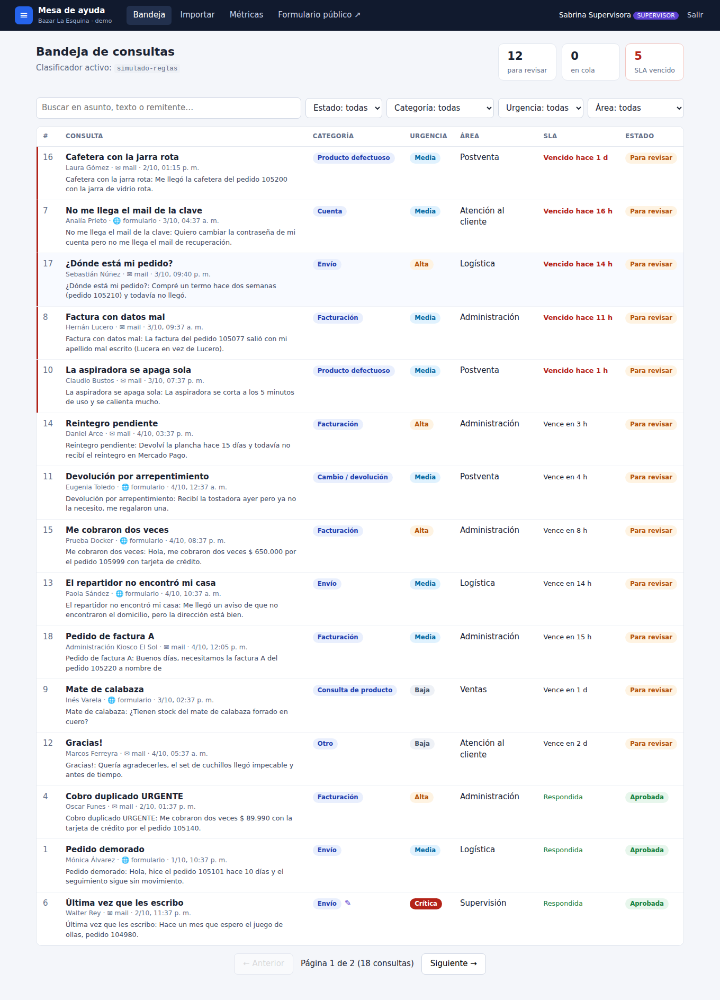
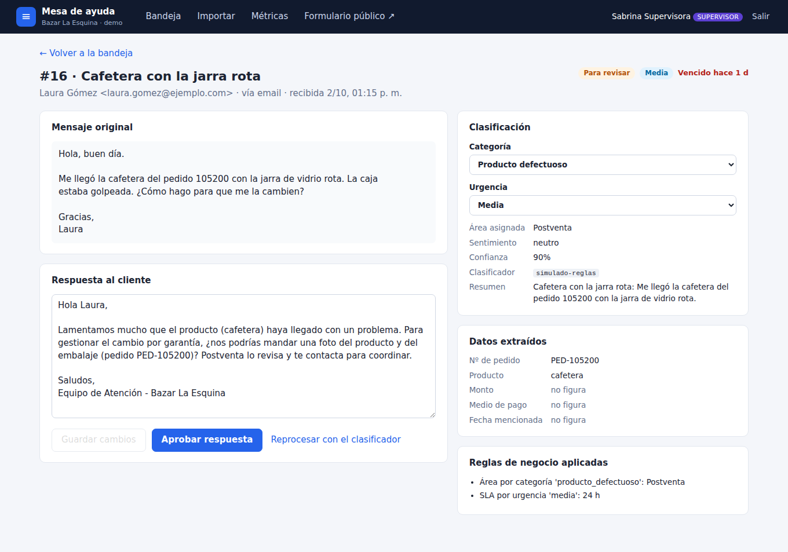
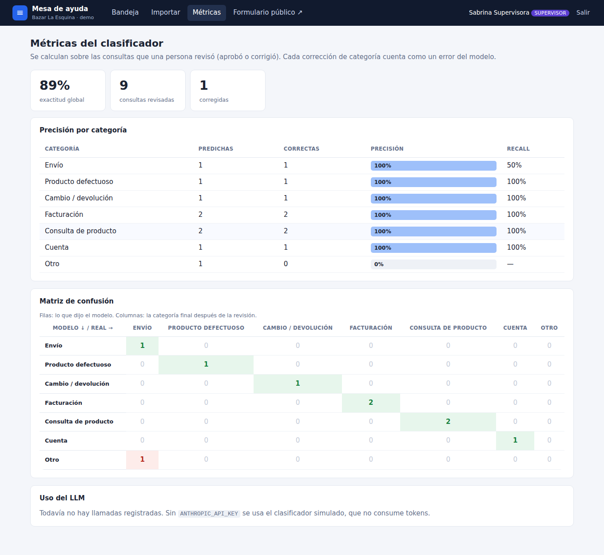
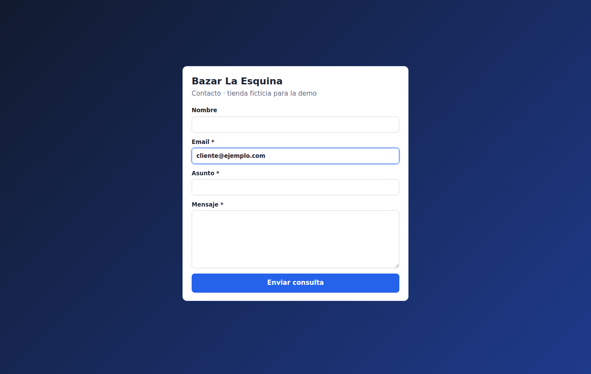

[Versión en castellano](README.md)

# AI customer inquiry classifier

Portfolio project by **Joaquin Alejandro Bobbio** (Programming degree student at UNAHUR, Argentina). All data is **sample data**: the "Bazar La Esquina" store, its customers, orders and emails are made up. The UI and the domain code are in Spanish, like the rest of my projects.

A fictional small business receives questions and complaints through a **web form** and by **email** (simulated by importing `.eml` or JSON files). Each inquiry goes into a **Redis queue**; a **worker** picks it up and asks an **LLM (Claude)** for a **Pydantic-validated JSON** with category, urgency, sentiment, summary, extracted data (order number, product, amount…) and a draft reply. Then deterministic **business rules** assign a team and an SLA. A human reviews everything in a **React + TypeScript panel**: filters the inbox, edits the draft, fixes the category and approves. Corrections are stored and feed a **per-category precision metric**.

> **Without `ANTHROPIC_API_KEY` the system uses a simulated classifier** (deterministic keyword rules). That way the demo, the worker and every test run with no key and no cost. With the key set, the same flow uses Claude. The panel and `/api/salud` always show which one is active.



## Why this project

I built it targeting **Python/FastAPI developer**, **full stack with AI** and **AI Automation Developer** job posts, which ask for Python, FastAPI, React, TypeScript, PostgreSQL, Redis, Docker, REST APIs and LLM usage. My other projects already cover a pandas ETL + FastAPI + Streamlit and an AI tutor in Node; this one focuses on something else: **automating a business process with an LLM**, with structured output, a job queue, human review and measuring how well the model performs.

## Stack

| Part | Technologies |
|---|---|
| API | Python 3.11, FastAPI, Pydantic v2, SQLAlchemy 2, Alembic, JWT (PyJWT + bcrypt) |
| Queue / worker | Redis + RQ |
| LLM | Claude API with the official `anthropic` SDK (default model `claude-sonnet-5-5`, configurable) |
| Database | PostgreSQL 16 (JSONB for extracted data and applied rules) |
| Panel | React 19 + TypeScript + Vite, React Router |
| Quality | pytest (unit + integration against real Postgres and Redis), ruff, Vitest, oxlint |
| Infra | Docker, docker compose, GitHub Actions |

## Architecture

```
 Web form ───────┐                                        ┌──────────────┐
 .eml/JSON import┼─► FastAPI ──► PostgreSQL (inquiry      │  Claude API  │
                 │      │         'pendiente')            │ (or simulated)│
                 │      └──► Redis (RQ queue) ──► Worker ─┤              │
                 │                                │       └──────────────┘
                 │                                ▼
                 │          Pydantic-validated JSON ──► Business rules
                 │                                       (team + SLA)
                 │                                │
 React panel ◄───┴──── REST API (JWT) ◄───────────┘  inquiry 'clasificada'
  (inbox, detail, correct, approve, metrics)
```

Inquiry states: `pendiente` (pending) → `en_proceso` (processing) → `clasificada` (classified, waiting for review) → `aprobada` (approved), or `error` (can be reprocessed).

## How to run it

### Option 1: Docker (recommended, also on Windows 10 with Docker Desktop)

```bash
cp .env.example .env          # on Windows: copy .env.example .env
docker compose up --build
```

- Panel: http://localhost:5174 (the container's nginx also proxies the API)
- API: http://localhost:8083 — interactive docs at http://localhost:8083/docs
- Public store contact form: http://localhost:5174/contacto

On startup the API runs the migrations and loads the demo (users + 14 already classified inquiries, some reviewed). To use Claude, put your key in `.env` (`ANTHROPIC_API_KEY=...`) before starting. Note: with a key, the demo seed also classifies those 14 inquiries with Claude.

On Windows 10: install Docker Desktop (with WSL 2), open PowerShell in the project folder and run the same commands. If ports 8083 or 5174 are taken, change them in `docker-compose.yml`.

To stop: `docker compose down` (add `-v` to also delete the database).

### Option 2: app without Docker

You need PostgreSQL and Redis. If you don't have them, start them with Docker on ports that don't clash:

```bash
docker run -d --name consultas-pg -e POSTGRES_USER=consultas -e POSTGRES_PASSWORD=consultas \
  -e POSTGRES_DB=consultas_dev -p 54322:5432 postgres:16-alpine
docker run -d --name consultas-redis-dev -p 63792:6379 redis:7-alpine
docker exec consultas-pg psql -U consultas -c "create database consultas_test"
```

Backend (Linux / macOS):

```bash
cd backend
python3.11 -m venv .venv && source .venv/bin/activate
pip install -r requirements-dev.txt
cp .env.example .env
alembic upgrade head
python -m app.seed
uvicorn app.main:app --port 8083 --reload
# in another terminal, the worker:
rq worker --url redis://localhost:63792/0 consultas
```

On Windows (PowerShell): `py -3.11 -m venv .venv`, `.venv\Scripts\Activate.ps1`, the rest is the same. **The RQ worker does not run natively on Windows** (it relies on `fork` and Unix signals): on Windows run the worker with `docker compose up worker` or from WSL. I did not test it on a real Windows machine.

Panel:

```bash
cd frontend
npm install
npm run dev      # http://localhost:5174 (proxies /api to localhost:8083)
```

### Demo users

| Email | Password | Role |
|---|---|---|
| supervisor@demo.local | demo1234 | supervisor (sees metrics, can re-enqueue) |
| operador@demo.local | demo1234 | operator (reviews, corrects and approves) |

## Screens

| Screen | What it does |
|---|---|
| **Inbox** (`/`) | Sorted by SLA due time. Filters by state, category, urgency, team, text search and "SLA overdue". Auto-refreshes every 10 s because the worker runs in the background. |
| **Detail** (`/consultas/:id`) | Original message, editable draft, category/urgency correction, extracted data, applied rules, correction history, approve and reprocess. |
| **Import** (`/importar`) | Upload `.eml` files and JSON batches (simulates the mailbox). |
| **Metrics** (`/metricas`, supervisor only) | Overall accuracy, per-category precision and recall, confusion matrix and LLM usage (tokens, estimated cost, latency). |
| **Public form** (`/contacto`) | The store's contact form, no login. |







## Main endpoints

| Method and path | Auth | Description |
|---|---|---|
| `POST /api/auth/login` | — | Returns the JWT and the user |
| `GET /api/auth/yo` | JWT | Current user |
| `POST /api/consultas/formulario` | — | Public form: stores and enqueues |
| `GET /api/consultas` | JWT | Inbox with filters (`estado`, `categoria`, `urgencia`, `area`, `canal`, `q`, `sla_vencido`) and paging |
| `GET /api/consultas/{id}` | JWT | Detail with corrections |
| `PATCH /api/consultas/{id}` | JWT | Edit the draft, correct category or urgency (recorded) |
| `POST /api/consultas/{id}/aprobar` | JWT | Approves the final reply |
| `POST /api/consultas/{id}/reprocesar` | JWT | Sends it back to the queue |
| `POST /api/consultas/reencolar-pendientes` | supervisor | Re-enqueues everything pending (in case Redis was down) |
| `POST /api/ingreso/eml` | JWT | Imports one or more `.eml` files (multipart) |
| `POST /api/ingreso/json` | JWT | Imports a JSON batch (deduplicated by `id_externo`) |
| `GET /api/metricas/resumen` | JWT | Counts by state/team, overdue SLAs and active classifier |
| `GET /api/metricas/precision` | supervisor | Per-category precision and recall + confusion matrix (`?clasificador=` to filter) |
| `GET /api/metricas/uso-llm` | supervisor | Tokens, estimated cost and latency per model |
| `GET /api/salud` | — | Database, Redis and active classifier status |

## Technical decisions

- **RQ, not Celery or arq.** There is a single synchronous task (classify one inquiry). RQ only needs Redis, starts with one command and is easy to test with a burst worker. Celery adds configuration that brings nothing here; arq forces everything to be async while I use the SDK and SQLAlchemy synchronously. The downside of RQ: it does not run natively on Windows.
- **Only the id goes into the queue.** The worker reads the inquiry from the database, so a retry always works with current data.
- **Structured output + Pydantic.** The JSON Schema is generated from the same Pydantic model (`ResultadoClasificacion`) and sent in `output_config.format`, so Claude answers in that shape. The response is still validated with Pydantic before saving; if it fails, it counts as a failed attempt and is retried. I use structured output instead of "forced tool use" because current models reject a forced `tool_choice`, and for getting JSON back it is the most direct option.
- **Own retries with exponential backoff + jitter** (429, 5xx, timeouts and invalid JSON). 400 errors and model refusals are not retried because they would fail the same way. SDK retries are disabled (`max_retries=0`) to avoid double retries and to count attempts.
- **Configurable timeout** (`LLM_TIMEOUT_SEGUNDOS`, 30 s by default).
- **Tokens and cost.** Every call is stored in `usos_llm` (input and output tokens across all attempts, estimated cost from reference per-million-token prices, latency, success or error). If the API answered with another model through the fallback, the cost uses that model.
- **Server-side fallback** (`LLM_FALLBACK_SERVIDOR=true`): if the model refuses an inquiry for safety reasons, the API retries it on another model within the same call. It can be turned off.
- **Low effort** (`LLM_ESFUERZO=low`): classification does not need deep reasoning, and it lowers cost and latency. Configurable.
- **Business rules are not decided by the LLM.** The model proposes category and urgency; team and SLA come from Python rules that are easy to audit and test (e.g. a mention of the consumer protection office or a legal complaint escalates to Supervision with critical urgency; billing with an amount ≥ ARS 500,000 is at least high). Each inquiry stores the list of rules applied to it.
- **Prompt injection.** Customer text goes inside `<consulta>` tags and the prompt states it is data to analyze, not instructions. The evaluation set includes a case that tries to manipulate the reply. Also, nothing is sent automatically: there is always human approval.
- **Measuring precision from real use.** The model's answer (`categoria_modelo`) is stored next to the post-review value. Approving without changes counts as a hit; correcting counts as a miss. That gives precision, recall and a confusion matrix. Each correction is stored in `correcciones` with user and timestamp.
- **If Redis is down** the inquiry is still saved as `pendiente` and can be re-enqueued later (supervisor endpoint).
- **Email dedupe** by `Message-ID` (unique `id_externo`).
- **Intentionally simple email validation**: `email-validator` rejects reserved domains like `.local` or `.example`, which the demo uses.

## Tests

```bash
cd backend
pytest -v                     # 84 tests: unit + integration (needs Postgres and Redis)
pytest -m "not integracion"   # unit tests only, no database or Redis
ruff check . && ruff format --check .

cd ../frontend
npm test                      # Vitest (formatting functions)
npm run lint && npm run build
```

By default tests use the `consultas_test` database on `localhost:54322` and Redis DB 15 on `localhost:63792`; override with `TEST_DATABASE_URL` and `TEST_REDIS_URL`. Integration tests recreate the schema by running the Alembic migrations.

Coverage:

- **Claude classifier with a fake client** (no key or network in tests): request parameters (model, schema, fallback), backoff retries on 429 and timeout, retry on invalid JSON adding up tokens, retries exhausted, 400 without retry, `refusal`, cost based on the model that answered.
- Simulated classifier, data extraction, business rules, costs, `.eml` parsing.
- API against real PostgreSQL: login and roles, form, filters, correction, approval, reprocess, imports, metrics.
- Real RQ worker against real Redis (burst mode), and the flow with mocked Claude storing tokens and cost.
- The evaluation script.

## Classifier evaluation

`backend/evaluacion/consultas_etiquetadas.json` holds **40 made-up inquiries in Rioplatense Spanish**, hand-labeled with category and urgency (including ambiguous cases and one prompt-injection attempt).

```bash
cd backend
python evaluar.py --simulado            # rule-based baseline
python evaluar.py                       # active classifier (Claude if a key is set)
python evaluar.py --limite 10 --salida result.json
python evaluar.py --umbral 0.8          # exit code 1 if below (used by CI)
```

**Simulated** classifier result: 87.5% category accuracy and 70% urgency accuracy. It fails, for example, when a shipping complaint uses no shipping words ("incomplete order") or when words from another category appear ("scammers… I paid by bank transfer"). **I could not measure Claude** because there was no key in the environment where I built it: it is the first thing I would do with one.

## What is NOT included or was not tested

- **The real Claude API was never called.** The real classifier is fully tested with a fake client; the request shape (structured output, `fallbacks`, `effort`) follows the documentation of the official `anthropic` 1.x SDK, but I did not verify it against the live service. There are no `evaluar.py` results with Claude.
- Prices used for the cost estimate are reference values set by hand in `costos.py`; the real cost comes from the Anthropic console.
- No real emails are sent: "approve" stores the final reply. There is no IMAP connection either; email is simulated with `.eml`/JSON.
- No rate limiting or captcha on the public form.
- No refresh tokens: the JWT lasts 8 hours. The token is kept in `localStorage` (simple for a demo; in production I would consider httpOnly cookies).
- `docker compose build` and `docker compose up` were verified on Linux (panel, API, worker, Postgres and Redis running, a form inquiry classified by the worker). The environment had a proxy with its own certificate, so I had to add that certificate to the build with a separate file that is not part of the project. Not tested on Windows, and the GitHub Actions workflow was not run on GitHub.
- The RQ worker does not run natively on Windows (see above).
- Few frontend tests (formatting functions); screens were tested by hand and with the Playwright screenshots.

## How to talk about it in an interview

1. **The problem:** a small business gets complaints through several channels and someone has to read, classify and route them. I automated the first pass with an LLM, but a person still makes the final call.
2. **Structured output:** the model does not return free text but JSON with a schema generated from Pydantic, which I validate again before saving. If it fails, I retry.
3. **Queue and worker:** the form answers immediately and the classification (which can take seconds or fail) happens in the background with RQ on Redis. If Redis is down, nothing is lost.
4. **Robustness:** exponential backoff with jitter only for transient errors, timeouts, and token/cost logging for every call.
5. **Business rules outside the LLM:** team and SLA come from deterministic, testable code; the LLM proposes, the rules decide.
6. **Measuring:** I store what the model said and what the person corrected, and compute per-category precision. I also have a 40-inquiry labeled set and a script that measures any classifier.
7. **Keyless demo:** without `ANTHROPIC_API_KEY` it uses a rule-based classifier, so anyone can run it and tests don't depend on the network.
8. **Real tests:** integration against real Postgres and Redis, with an RQ worker processing jobs, and a mocked Claude client.

**Likely questions**

- *Why RQ and not Celery?* One synchronous task; RQ only needs Redis and is much simpler. If I needed workflows, complex priorities or scheduled tasks, I would look at Celery.
- *What if the LLM returns garbage?* Structured output enforces the format and Pydantic validates it again; on failure I retry, and if attempts run out the inquiry goes to `error` with the details and can be reprocessed.
- *How do you know the model works well?* With the evaluation set before changing anything, and in production with the operators' corrections (precision, recall and confusion matrix).
- *What about prompt injection?* Customer text is delimited and marked as data, the model has no tools that take actions, and nothing goes out without human approval.
- *How much does it cost?* Every call logs tokens and estimated cost; with low effort and short replies the estimate is under one US cent per inquiry (about 1,500 input and 500 output tokens), and it shows up in the metrics panel.
- *What would you improve?* Measure with real Claude and tune the prompt against the evaluation set, real email sending, IMAP, rate limiting on the form, and more frontend tests.
